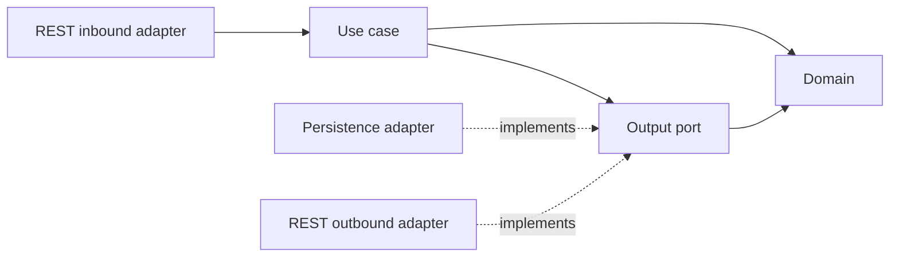
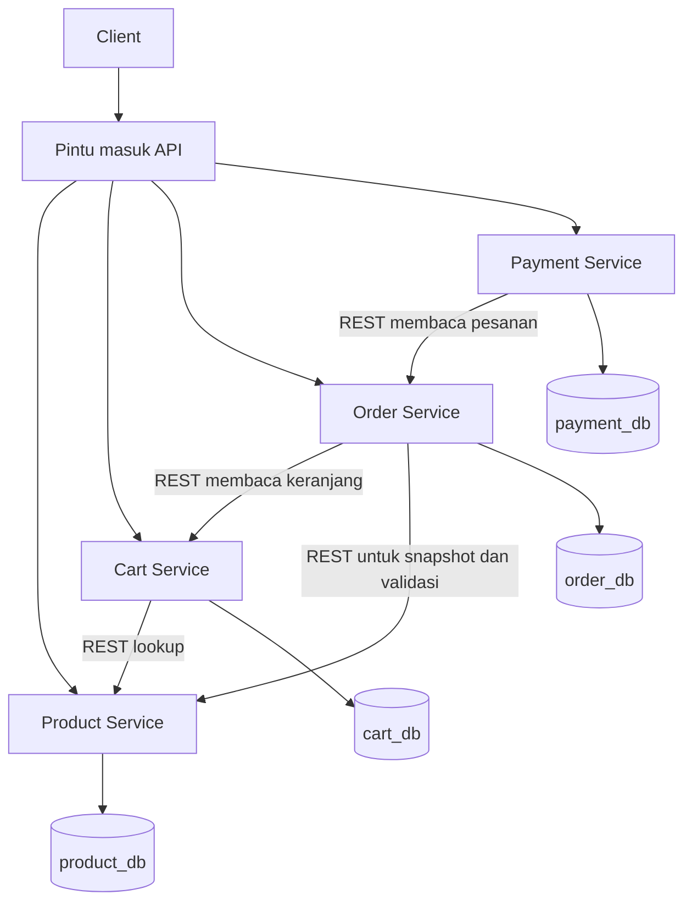
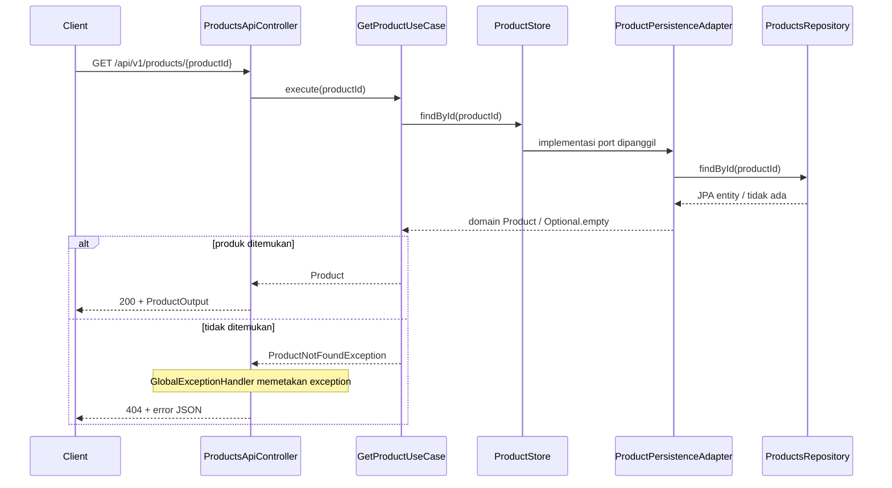

# Architecture Overview

[Kembali ke README](../README.md)

## Daftar isi

- [Pendahuluan](#pendahuluan)
- [Pola arsitektur](#pola-arsitektur)
- [Arsitektur sistem](#arsitektur-sistem)
- [Struktur direktori](#struktur-direktori)
- [Tanggung jawab layer](#tanggung-jawab-layer)
- [Alur data](#alur-data)
- [Pola desain](#pola-desain)
- [Organisasi setiap service](#organisasi-setiap-service)
- [Transaksi dan konsistensi](#transaksi-dan-konsistensi)
- [Konfigurasi dan deployment](#konfigurasi-dan-deployment)
- [Pengujian dan manfaat rancangan](#pengujian-dan-manfaat-rancangan)
- [Batas implementasi](#batas-implementasi)

## Pendahuluan

Project ABL membagi backend e-commerce menjadi **Product, Cart, Order, dan Payment**. Setiap layanan memiliki tanggung jawab dan kontrak REST/JSON yang jelas. Struktur kode memisahkan **domain, use case, ports, dan adapters**, dengan peran boundary, control, dan entity yang terdefinisi.

Tujuan rancangan adalah memperjelas lokasi aturan bisnis, memisahkan kontrak HTTP dari persistence, dan memungkinkan pengujian komponen melalui interface. Struktur direktori dan diagram di sini merupakan **rancangan yang dituju**. Status terakhir yang terkonfirmasi baru skeleton/module Maven, struktur package yang mulai disiapkan, dan kontrak API. Belum ada bukti implementasi penuh, tests bisnis, atau deployment selesai.

## Pola arsitektur

### 1. Microservices berdasarkan kapabilitas bisnis

| Layanan | Kapabilitas | Batas tanggung jawab |
|---|---|---|
| Product | Katalog, harga, stok produk | Menguasai informasi Product; bukan penyimpanan seluruh transaksi pelanggan |
| Cart | Keranjang dan item belanja | Mengelola aggregate Cart dengan identifier productId |
| Order | Pesanan | Mengelola state pesanan dan rancangan snapshot OrderItem |
| Payment | Permintaan pembayaran | Mengelola Payment; status final memerlukan mekanisme verifikasi terpercaya |

Keempatnya adalah aplikasi/JAR terpisah dalam satu repository Maven. Satu repository tidak mewajibkan satu proses atau deployment serentak. Independensi deployment tetap harus dibuktikan lewat kontrak kompatibel, build/release, dan pengujian yang sesuai.

### 2. Pemisahan domain, aplikasi, dan adapter

```text
┌────────────────────────────────────────────────────┐
│ Infrastruktur dan framework                        │
│ Spring Boot/MVC, Spring Data JPA, PostgreSQL, HTTP   │
├────────────────────────────────────────────────────┤
│ Adapters                                           │
│ REST controller, persistence adapter, remote client │
├────────────────────────────────────────────────────┤
│ Application / usecase                              │
│ Koordinator skenario, command, output ports          │
├────────────────────────────────────────────────────┤
│ Domain                                             │
│ Model bisnis, invariant, state dan domain error      │
└────────────────────────────────────────────────────┘
```

Dependency source menuju model dan interface internal. Domain tidak bergantung pada DTO HTTP, JPA entity, repository Spring Data, atau RestClient. Rancangan mengizinkan `@Service`/`@Transactional` di application layer untuk kepraktisan Spring; pemisahan domain tidak berarti seluruh aplikasi bebas framework.

### 3. Ports and adapters

- **Output port** berada di `usecase.port.out`, misalnya `ProductStore` atau `ProductLookup`.
- **Database adapter** mengimplementasikan kebutuhan simpan/baca menggunakan Spring Data JPA.
- **REST adapter** mengimplementasikan kebutuhan lookup service lain menggunakan HTTP client.
- **Inbound adapter** menerima request, memetakan input ke command, memanggil use case, dan menyusun output HTTP.



Panah dependency source di atas berbeda dari urutan pemanggilan runtime: pada runtime, pemanggilan port dilayani implementasi adapter yang diinjeksi Spring.

### 4. Pemetaan BCE

| Peran BCE | Komponen project |
|---|---|
| Boundary | `adapter.inbound.rest`: API/controller, input/output DTO, mapper HTTP |
| Control | `usecase.service`: koordinator skenario dan cabang alternatif |
| Entity | `domain`: data dan invariant bisnis |
| Persistence | Output port serta database adapter/repository/JPA entity |

Spring Controller berperan sebagai boundary, sedangkan use case mengoordinasikan alur bisnis. Domain entity menyimpan model serta invariant bisnis; JPA entity memetakan penyimpanan database.

## Arsitektur sistem



Setiap layanan mengakses kebutuhan data eksternalnya melalui lookup API. Order membaca Product untuk memperoleh nama/harga yang belum tersedia lengkap dalam respons Cart awal; policy harga saat checkout masih perlu diputuskan.

Pintu masuk API pada diagram adalah komponen logis. Target deployment memakai Istio ingress, tetapi ingress/cluster belum dijalankan. Saat development langsung pada host, client dapat mengakses service melalui port lokal masing-masing.

### Kepemilikan data

```text
Product → product_db → rancangan products
Cart    → cart_db    → rancangan carts dan cart_items
Order   → order_db   → rancangan orders dan order_items
Payment → payment_db → rancangan payments
```

Foreign key hanya menghubungkan entity dalam database layanan yang sama. Cart/Order menyimpan productId, Payment menyimpan orderId; tidak ada query JOIN langsung ke database service lain. Tipe kolom, constraint, snapshot, locking, dan retention internal perlu ditetapkan melalui migrasi serta [decisions](decisions.md).

## Struktur direktori

### Repository

```text
ABL-Project/
├── pom.xml                         # Parent/aggregator Maven
├── mvnw, mvnw.cmd
├── .mvn/wrapper/
├── services/
│   ├── product-service/
│   ├── cart-service/
│   ├── order-service/
│   └── payment-service/
├── specs/openapi.yaml               # Kontrak publik gabungan
├── docs/                           # Dokumentasi desain/development/tests
├── deploy/                         # Manifests/chart, ditulis saat deployment
├── scripts/                        # Otomatisasi sesuai kebutuhan
└── tests/                          # Pengujian lintas service
```

### Satu service, dicontohkan Product

```text
product-service/
├── pom.xml
├── Dockerfile                      # Ditambahkan saat menyiapkan image
└── src/
    ├── main/
    │   ├── java/id/ac/ub/abl/product/
    │   │   ├── ProductApplication.java
    │   │   ├── domain/
    │   │   │   ├── Product.java
    │   │   │   └── exception/DomainRuleViolation.java
    │   │   ├── usecase/
    │   │   │   ├── command/           # Create/replace/patch commands
    │   │   │   ├── service/           # Handler skenario
    │   │   │   ├── port/out/ProductStore.java
    │   │   │   └── exception/ProductNotFoundException.java
    │   │   ├── adapter/
    │   │   │   ├── exception/GlobalExceptionHandler.java
    │   │   │   ├── inbound/rest/
    │   │   │   │   ├── ProductsApi.java
    │   │   │   │   ├── ProductsApiController.java
    │   │   │   │   ├── dto/           # ProductInput, ProductPatchInput, ProductOutput
    │   │   │   │   └── mapper/ProductHttpMapper.java
    │   │   │   └── outbound/database/
    │   │   │       ├── ProductPersistenceAdapter.java
    │   │   │       ├── ProductsRepository.java
    │   │   │       ├── entity/ProductJpaEntity.java
    │   │   │       └── mapper/ProductPersistenceMapper.java
    │   │   └── configuration/
    │   └── resources/
    │       ├── application.properties # YAML juga dapat dipilih secara konsisten
    │       └── db/migration/
    └── test/java/id/ac/ub/abl/product/
        ├── domain/
        ├── usecase/
        └── adapter/
```

Cart, Order, dan Payment menambahkan `adapter/outbound/rest/{dto,mapper}` serta konfigurasi HTTP client. Spring Initializr membuat kerangka framework, sedangkan kelas bisnis di atas masih harus ditulis. Tampilan compact IDE `adapter.inbound.rest` mewakili folder bersarang `adapter/inbound/rest`.

## Tanggung jawab layer

### 1. Domain

**Lokasi:** `domain/`.

Berisi aggregate/entity bisnis, enum/state, snapshot yang dibutuhkan consumer, dan exception invariant. Contoh method yang direncanakan: `Product.changePrice`, `Cart.addItem`, `Order.changeShippingAddress`, dan `Payment.changeReference`.

Aturan:

- Menjaga invariant, misalnya harga/stok tidak negatif dan quantity valid.
- Tidak melakukan query, HTTP call, atau membuat ResponseEntity.
- Tidak memakai annotation JPA atau DTO respons remote.
- Snapshot consumer dimiliki service yang membutuhkannya, bukan mengimpor entity service lain.

### 2. Application / use case

**Lokasi:** `usecase.command`, `usecase.service`, `usecase.port.out`, `usecase.exception`.

Handler mengoordinasikan urutan pesan skenario, memanggil domain, memilih cabang alternatif, dan memakai output port. Command adalah data input aplikasi; tidak perlu membawa annotation HTTP/JPA.

Contoh handler: `CreateProductUseCase`, `AddCartItemUseCase`, `CreateOrderUseCase`, `CreatePaymentUseCase`. Pembagian handler per operasi adalah pilihan teknis; satu use case bisnis dapat mencakup beberapa operasi HTTP.

### 3. Inbound REST adapter

**Lokasi:** `adapter.inbound.rest`.

- API/controller menetapkan route, menerima input, dan memilih status/header HTTP.
- DTO serta validation memeriksa bentuk input jaringan.
- Mapper mengubah input menjadi command dan domain hasil menjadi output publik.
- Tidak menghitung transaksi bisnis, menjalankan SQL, atau memanggil layanan lain langsung dari controller.

Interface `ProductsApi` adalah kontrak HTTP bila digunakan; bukan interface persistence. Penempatan annotation mapping pada interface/implementasi harus konsisten agar route tidak berbeda atau terdaftar ganda.

### 4. Database adapter dan repository

**Lokasi:** `adapter.outbound.database`.

| Komponen | Fungsi |
|---|---|
| `ProductStore` | Port aplikasi pada `usecase.port.out`, memakai domain/tipe aplikasi |
| `ProductPersistenceAdapter` | Implements port; mengoordinasikan mapping dan pemanggilan repository |
| `ProductsRepository` | Interface Spring Data, misalnya JpaRepository untuk ProductJpaEntity |
| `ProductJpaEntity` | Mapping tabel/kolom/relasi persistence |
| `ProductPersistenceMapper` | Konversi domain ↔ JPA entity |

Jadi repository tetap ada meskipun tidak ada folder terpisah bernama `repository`. Core hanya mengetahui port. Mapping harus menjaga ID, identitas item aggregate, dan version bila optimistic locking dipakai; jangan menghilangkan data kontrol concurrency saat memetakan objek.

### 5. Outbound REST adapter

**Lokasi:** `adapter.outbound.rest`.

Adapter mengimplementasikan port lookup, memakai RestClient, membaca respons remote, dan memetakannya ke snapshot lokal. Ia membedakan resource tidak ada dari timeout/koneksi/5xx. Rincian error publik perlu mengikuti kontrak yang disepakati.

DTO remote seperti `ProductApiResponse` tidak dikembalikan langsung ke use case. Contoh transformasi: `ProductApiResponse → ProductSnapshot` milik Cart/Order.

### 6. Configuration dan error adapter

`configuration/` berisi wiring teknis, properties, dan bean HTTP client. Main class berada pada akar package service agar component scanning mencakup subpackage.

`adapter.exception` memetakan exception domain/usecase ke respons HTTP `{code,message}`. Domain/usecase tidak mengimpor exception yang hanya didefinisikan pada adapter. Data per-request tidak disimpan sebagai field mutable pada controller singleton.

## Alur data

### Request dan response umum

```text
1. HTTP request diterima controller.
2. DTO divalidasi dan dipetakan ke command.
3. Use case menjalankan langkah skenario dan aturan domain.
4. Use case memanggil output port bila memerlukan data/penyimpanan.
5. Adapter melakukan query JPA atau HTTP request dependency.
6. Adapter memetakan hasil menjadi domain/snapshot milik aplikasi.
7. Use case mengembalikan hasil atau exception aplikasi.
8. HTTP mapper/controller menyusun response; exception handler menangani error.
```

### Contoh: mengambil detail Product



Lifeline ProductStore menunjukkan dispatch melalui interface, bukan proses/server tambahan. Diagram adalah rancangan alur; nama method diselaraskan dengan class/sequence diagram saat kode ditulis.

### Alur lintas layanan

| Skenario | Urutan aplikasi yang direncanakan | Hal yang perlu diputuskan |
|---|---|---|
| Tambah item Cart | Load Cart → ProductLookup → domain.addItem → save Cart | Perilaku item duplikat, harga Cart, stok/state |
| Buat Order | CartLookup → ProductLookup → snapshot/total → save Order dan item | Harga checkout, Cart kosong/ownership, reservation |
| Buat Payment | OrderLookup → cek kelayakan → create Payment → save | Status awal, payment attempts, idempotency, verifikasi final |

## Pola desain

### 1. Constructor dependency injection

Use case menerima interface output port melalui constructor. Spring menyuntikkan adapter implementasinya, sehingga unit test dapat menyediakan mock/fake tanpa menjalankan database.

```java
// Contoh rancangan; domain dan implementasi port dibuat terpisah.
public class GetProductUseCase {
    private final ProductStore store;

    public GetProductUseCase(ProductStore store) {
        this.store = store;
    }
}
```

Jika memakai class sebagai bean Spring, daftarkan melalui `@Service` atau konfigurasi bean yang konsisten. Jangan membuat dependency dengan `new` tersebar pada controller/use case.

### 2. Interface segregation

Port hanya menyatakan kemampuan yang diperlukan consumer, misalnya `ProductLookup.getById`. Pisahkan lookup remote dari operasi persistence lokal. Hindari interface besar yang memaksa setiap adapter mengimplementasikan operasi yang tidak dibutuhkannya.

### 3. Repository dan persistence adapter

Spring Data repository menyediakan operasi persistence untuk JPA entity. Output port menjaga agar detail tersebut tidak menjadi dependency langsung use case. Perubahan implementasi penyimpanan tetap memerlukan kesetaraan perilaku, migrasi, dan tests; interface bukan jaminan pergantian database tanpa pekerjaan.

### 4. DTO, command, domain, dan mapper

```text
HTTP ProductInput → CreateProductCommand → domain.Product
                                      ↔ ProductJpaEntity melalui persistence mapper
Domain hasil → ProductOutput → JSON response
```

DTO HTTP menjaga bentuk API; command membawa input aplikasi; domain menjaga aturan; JPA entity memetakan penyimpanan. Pemisahan ini mengurangi keterikatan kontrak pada detail database.

### 5. Exception dan error mapping

Domain/usecase menyatakan kegagalan yang bermakna. Adapter HTTP memilih response 400/404/409/500 sesuai operasi yang mendokumentasikannya. Penambahan error dependency 502/503/504 membutuhkan sinkronisasi OpenAPI.

Kontrak error memakai atribut `code` dan `message`. Response envelope atau daftar field errors tambahan perlu ditetapkan sebelum digunakan. Detail stack trace dan kredensial tidak disertakan pada respons publik.

## Organisasi setiap service

| Service | Domain utama | Port lokal/remote | Adapter utama |
|---|---|---|---|
| Product | Product | ProductStore | ProductPersistenceAdapter, ProductsRepository, ProductJpaEntity |
| Cart | Cart, CartItem, ProductSnapshot | CartStore, ProductLookup | CartPersistenceAdapter, CartsRepository, ProductRestAdapter |
| Order | Order, OrderItem, CartSnapshot, ProductSnapshot | OrderStore, CartLookup, ProductLookup | OrderPersistenceAdapter, OrdersRepository, CartRestAdapter, ProductRestAdapter |
| Payment | Payment, PaymentMethod/Status, OrderSnapshot | PaymentStore, OrderLookup | PaymentPersistenceAdapter, PaymentsRepository, OrderRestAdapter |

Repository item terpisah bersifat opsional bila aggregate parent sudah mencukupi kebutuhan query/persistence. Rancangan Product belum memerlukan adapter REST outbound. Entity/port bernama sama di dua consumer tetap dimiliki masing-masing service; tidak ada shared module entity JPA lintas aplikasi.

## Transaksi dan konsistensi

- `@Transactional` mengatur transaksi database lokal, bukan transaksi global Product–Cart–Order–Payment.
- Lookup HTTP dengan timeout sebaiknya tidak menahan lock/transaction SQL lebih lama dari yang diperlukan.
- Pemisahan remote lookup dan transaksi lokal tidak menghilangkan race terhadap perubahan stok/harga.
- Pengecekan stok bukan reservation atomik; concurrency/reservation merupakan pekerjaan desain lanjutan.
- Snapshot Order yang dipilih harus mempertahankan riwayat transaksi setelah katalog berubah.
- Retry operasi create/payment memerlukan policy idempotency sebelum diaktifkan otomatis.
- SUCCESS/FAILED pembayaran harus berasal dari verifikasi terpercaya; penulisan reference dan respons 201 tidak membuktikan transfer uang berhasil.

Batas transaksi dapat ditempatkan pada handler/local writer yang sesuai. Pemanggilan method transactional melalui `this` dalam bean yang sama tidak menciptakan batas proxy baru. Workflow compensation/Saga dan event broker belum termasuk implementasi yang dikonfirmasi.

## Konfigurasi dan deployment

### Development lokal

| Service | Port host | JDBC target contoh |
|---|---:|---|
| Product | 8081 | localhost:5433/product_db |
| Cart | 8082 | localhost:5434/cart_db |
| Order | 8083 | localhost:5435/order_db |
| Payment | 8084 | localhost:5436/payment_db |

Konfigurasi datasource/environment per terminal dijelaskan pada [development.md](development.md). URL/port pada tabel adalah pengaturan development lokal. `.env` tidak otomatis dimuat oleh Spring Boot.

### Target deployment berikutnya

Rancangan memakai Docker image per service, Kubernetes Service/DNS, Istio ingress/mesh, serta Helm untuk aplikasi. Semua aplikasi dapat memakai container port 8080 pada Pod berbeda. Namespace, resource budget, Secret, image tag/digest, probes, dan policy mesh ditentukan ketika setup deployment dimulai.

Deployment cluster merupakan tahap pengembangan berikutnya. Folder `deploy/` dan `scripts/` menampung konfigurasi serta otomatisasinya. Kesiapan database, mTLS, telemetry backend, dan workload cluster belum diverifikasi. Mesh transport tetap memerlukan otorisasi pengguna dan aturan bisnis pada aplikasi.

## Pengujian dan manfaat rancangan

| Tujuan | Cara memverifikasinya |
|---|---|
| Domain mudah diuji | Unit test invariant tanpa HTTP/database |
| Skenario dapat ditelusuri | Nomori pesan sequence dan hubungkan ke method/alternatif use case |
| Persistence sesuai desain | Tests PostgreSQL, mapping/constraint/version, dan migrasi |
| Kontrak stabil | Controller/contract tests dibandingkan dengan OpenAPI |
| Dependency gagal terkendali | Stub/timeout/5xx tests pada REST adapter dan use case |
| Independensi layanan | Build, pengujian, serta deployment per service dengan kontrak kompatibel |
| Kolaborasi tim | Batas data, port/interface, dan keputusan terdokumentasi |

Tujuan tersebut perlu dibuktikan oleh tests dan praktik pengembangan, bukan disimpulkan hanya dari banyaknya folder. Rencana 17 operasi, skenario lintas layanan, dan format bukti ada di [testing.md](testing.md).

## Batas implementasi

Kontrak publik terdiri dari 17 operasi pada 9 path dan tersedia pada [OpenAPI](../specs/openapi.yaml).

Bagian yang masih perlu ditetapkan meliputi pembuatan Cart awal, transisi state, policy snapshot/checkout, idempotency, dan integrasi provider pembayaran. Beberapa schema respons tambahan juga masih perlu dilengkapi; rinciannya ada pada [business-rules.md](business-rules.md).

Keputusan yang belum selesai tidak diperlakukan sebagai aturan final. Status, pilihan, serta konsekuensinya dicatat pada [decisions.md](decisions.md). Implementasi dan hasil pengujian diperbarui berdasarkan progres yang benar-benar tersedia.
